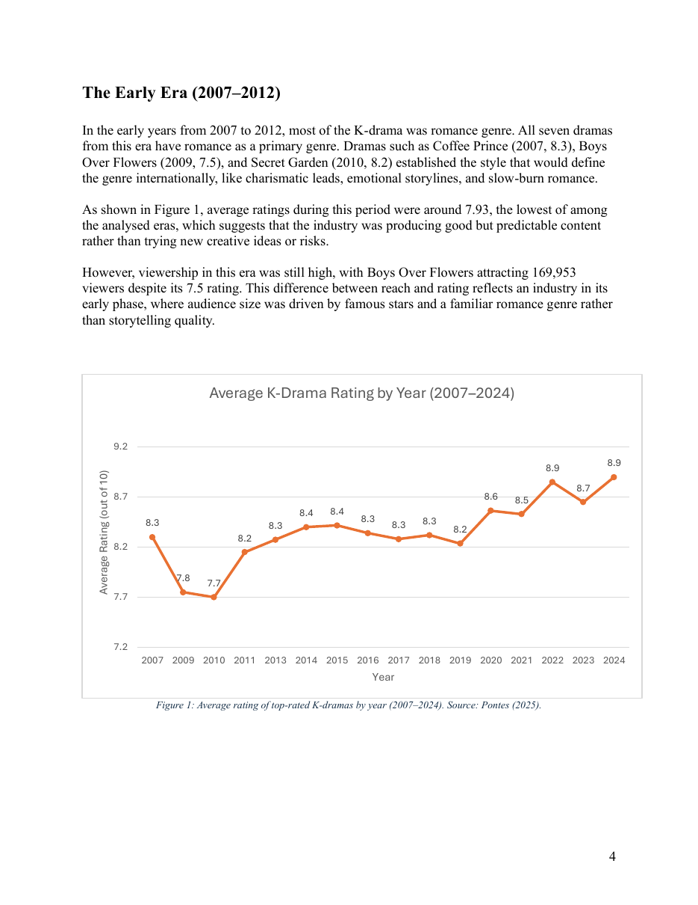
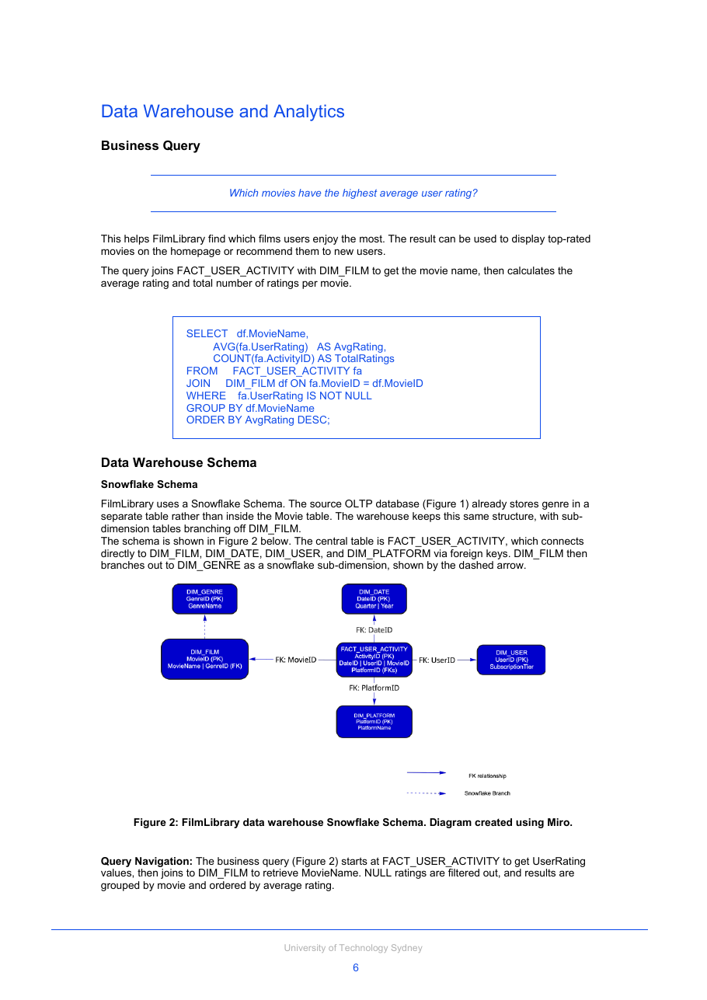
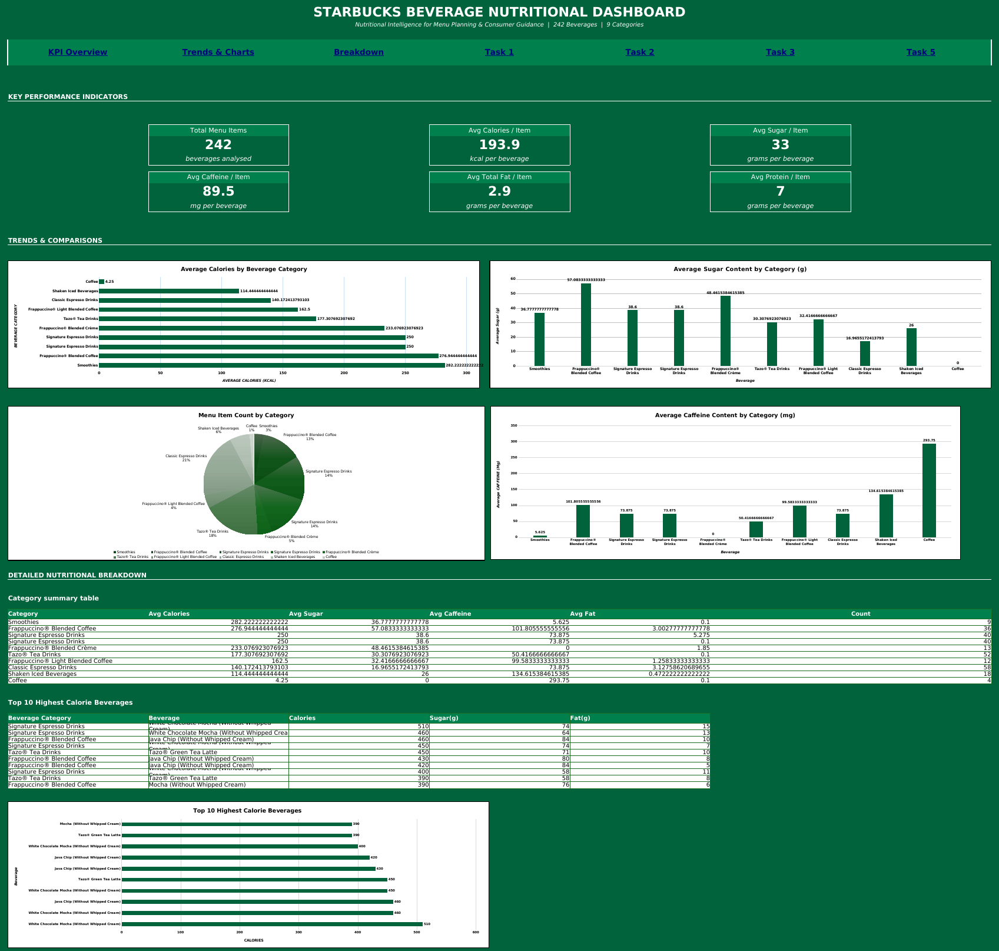

# Business Intelligence Coursework

Three pieces of work from **32558 Business Intelligence** (Master of Information Technology, University of Technology Sydney). They cover data storytelling, data warehouse design and dashboard design. All three are university coursework.

## 1. K-Drama Quality Over the Years (data storytelling)

**Files:** [Maniraj25379328Assg2.pdf](01-kdrama-data-storytelling/Maniraj25379328Assg2.pdf) (the report) and [Dataset from Kaggle.xlsx](01-kdrama-data-storytelling/Dataset%20from%20Kaggle.xlsx) (the raw data and my working sheets)

A written data-storytelling analysis of 100 top-rated Korean dramas (2007 to 2024). The dramas are grouped into five eras and compared on average rating, viewership and genre mix, to answer one question: how have ratings and viewership changed over time, and which era produced the best content?

- Average rating rose overall, from 7.9 in the Early Era (2007-2012) to 8.7 in the Global Era (2023-2024).
- Average viewership was highest in the Growth Era (2013-2016) and lowest in the Global Era.
- The share of dramas rated 8.8 or higher grew from 0% to 66.7% across the eras.

**Data:** [100 Most Popular K-Dramas, Kaggle](https://www.kaggle.com/datasets/vitoriapontes/top-100-most-popular-k-dramas-at-january-2025/data). The raw dataset and my working sheets are included in this folder.

## 2. FilmLibrary Data Warehouse Design

**File:** [Maniraj25379328Ass3.pdf](02-data-warehouse-design/Maniraj25379328Ass3.pdf)

A design document for a data warehouse for a fictional online movie platform. This is a design exercise: it describes the pipeline and schema, and does not include a built or deployed system.

- Data understanding and profiling across structured, semi-structured and unstructured sources.
- An extraction plan with the tools chosen for each source type.
- Data-quality issues and a cleansing plan: duplicate removal, standardising inconsistent genre names and handling missing values.
- A snowflake schema with a fact table for user activity and dimension tables for film, genre, platform, user and date.
- An incremental loading strategy, a business query in SQL, and metadata for the data elements.

## 3. Starbucks Beverage Nutrition Dashboard

**File:** [Maniraj25379328Assg4.xlsx](03-starbucks-excel-dashboard/Maniraj25379328Assg4.xlsx)

An Excel dashboard built on the Starbucks beverage nutrition dataset (242 menu items across 9 categories). It is designed for menu planners, dietitians and health-conscious consumers.

- KPIs for average calories, sugar, caffeine and fat by category, plus the 10 highest-calorie beverages.
- Formula-driven figures and charts, with the reasoning behind each visualisation choice.
- A section on ethical considerations: data privacy, transparency about data sources and cleaning, and avoiding misleading charts.

*Preview image of the Dashboard sheet. Open the .xlsx in Excel for the full interactive workbook.*

**Data:** [Starbucks Menu, Kaggle](https://www.kaggle.com/datasets/starbucks/starbucks-menu) (Creative Commons licence).

## Tools

Excel (dashboard), SQL and Python with Pandas (in the warehouse design), Miro and Draw.io (diagrams).
